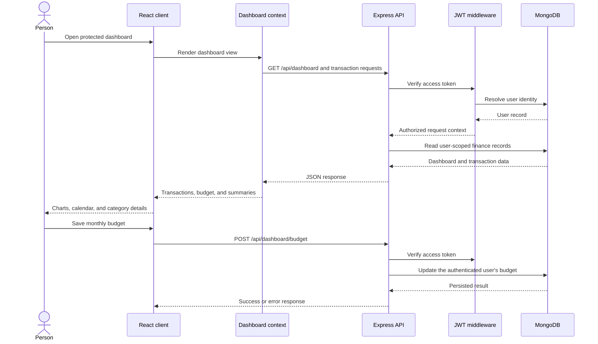

# System architecture

## Scope and evidence

The application is a browser-based React client and a separately started
Express API. The API connects to MongoDB before listening. Mongoose models
provide persistence. Google sign-in, Groq-backed AI, Stripe billing, and SMTP
email are optional integrations configured through server-side environment
variables.

The [interactive component diagram](.archify/architecture-finpilot-platform-20261023-0038/finpilot-platform.html)
is paired with an editable [diagram source](.archify/architecture-finpilot-platform-20261023-0038/candidate.json).
Its repository evidence is pinned to revision
`3310feb08ba1f319cecd4821e50871398a6e7ad4`. The local working tree used for
this documentation already contained unrelated edits; no claim is made that
those edits are part of the pinned revision.

## Request lifecycle

The dashboard context supplies transaction and budget state to the overview.
The overview derives its visualizations in the browser and sends budget edits
to the API; the API remains responsible for persistence and user scoping.

## Runtime responsibilities

| Runtime | Responsibilities |
| --- | --- |
| Browser client | React routes, auth/session UX, dashboard state, currency formatting, charts, and API requests |
| Express API | Route registration, authentication, validation, rate limiting, controllers, provider calls, and response/error handling |
| MongoDB | Durable application records accessed through Mongoose; the server establishes this connection before listening |
| External providers | Google identity verification, Groq completions, Stripe checkout/billing, and SMTP email when configured |

## Architectural constraints

- Client and server have separate manifests, lockfiles, environment files, and
  commands; there is no root npm workspace.
- The server's `/api` routes are mounted in `server/app.js`. Most feature APIs
  require a bearer access token; Stripe's webhook is a separate raw-body route.
- The overview uses dashboard context data and performs some aggregation in
  client-side code. Budget mutations are persisted through
  `POST /api/dashboard/budget`.
- The application has no checked-in Docker, Kubernetes, Terraform, or CI
  deployment definition in the inspected project.

## Change-impact guide

| Change | Update |
| --- | --- |
| New or changed route/auth guard | [API reference](../api-reference.md), [security](../security.md), route tests |
| Mongoose schema or ownership | [Data model](../data-model.md), migration/backfill notes if applicable |
| Provider or environment variable | [Development](../development.md), [operations](../operations.md), provider-data-flow review |
| Spending overview behavior | [Spending overview](../features/spending-overview.md) |
| Deployment topology or recovery controls | This document, [operations](../operations.md), and a dated ADR |
