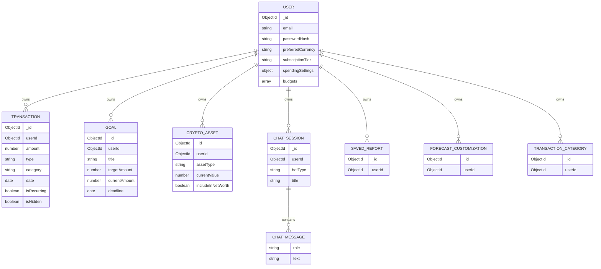

# Data model

The server uses MongoDB through Mongoose. The models below describe the
application concepts visible in the schema files, not a complete physical
database inventory. Fields and defaults can change; consult the linked model
before writing migrations, exports, or analytics.

## Ownership and core entities

The diagram shows ownership references used by the schemas; it does not imply
MongoDB-enforced foreign keys or automatic cascade deletion.

## Entity notes

- **User** — identity and authentication data, profile/financial preferences,
  preferred currency, subscription identifiers/status, usage counters,
  spending settings, budgets, and token/reset fields. Password and selected
  token fields are marked `select: false` in the schema.
- **Transaction** — `userId`, positive amount, `income`/`expense` type, date,
  optional category/merchant/notes/tag, review/visibility/recurring flags,
  categorization/import metadata. Compound indexes support user/date and
  user/type/category query patterns.
- **Goal** — user-owned target amount, current amount, category, deadline, and
  completion state. Progress and time-remaining values are virtuals.
- **CryptoAsset** — user-owned asset record. The schema includes crypto,
  equity, cash, property, debt, and other asset types, with type-specific
  fields.
- **ChatSession** — user-owned `ai_advisor` or `copilot` conversation containing
  timestamped user/bot messages.
- **SavedReport**, **ForecastCustomization**, and **TransactionCategory** —
  supporting user-scoped records; inspect each model for its current fields
  before building integrations.

## Data stewardship

- Treat financial, identity, goal, asset, transaction, and conversation fields
  as sensitive personal data.
- Avoid logging full transaction bodies, tokens, prompts, or provider payloads.
- AI chat context includes financial summary/category data, goals, recent
  transactions, trends, forecast/score values, and asset/equity summaries.
  Review the external AI provider's processing and retention terms before
  enabling it with real user data.
- No schema migration framework, retention schedule, data export/deletion
  inventory, or backup policy was identified in the inspected repository.
  Those are operational decisions, not properties guaranteed by these
  Mongoose schemas.

## Source models

- [`User.js`](../server/models/User.js)
- [`Transaction.js`](../server/models/Transaction.js)
- [`Goal.js`](../server/models/Goal.js)
- [`CryptoAsset.js`](../server/models/CryptoAsset.js)
- [`ChatSession.js`](../server/models/ChatSession.js)
